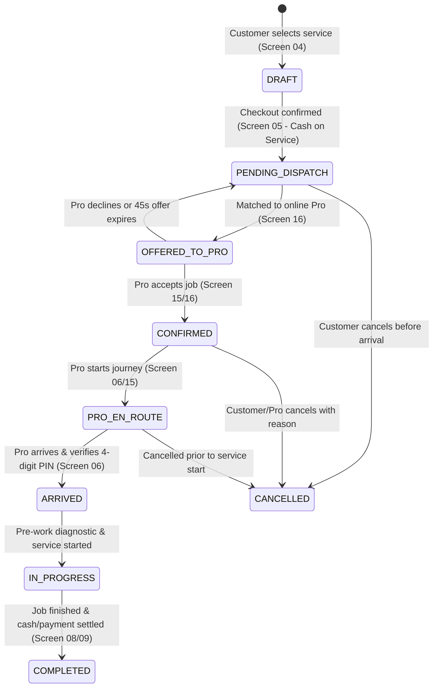

# FIXO — System Architecture (`docs/ARCHITECTURE.md`)

## 1. Executive Overview
**FIXO** is a bilateral Egyptian home-services marketplace connecting homeowners across Greater Cairo and Giza (Maadi, Zamalek, New Cairo, Sheikh Zayed, 6th of October, Dokki, Mohandessin) with skilled local technicians (HVAC, Plumbing, Electrical, Deep Cleaning, Carpentry, Painting).

This repository uses a mono-repo structure:
- `mobile/` — Native Flutter application (Customer + Professional roles in a single binary with role-aware routing).
- `backend/` — Modular NestJS TypeScript REST API backed by PostgreSQL and Prisma ORM.
- `admin/` — Reserved placeholder for a future back-office web portal (out of scope for current phases).
- `docs/` — Architecture, live Stitch MCP design reference (`docs/LIVE_STITCH_DESIGN.md`), implementation plan, database schema, API contracts, and audit logs.

---

## 2. Design System Reconciliation (Live Stitch MCP `projects/18114732464114306203`)
The live Stitch project (`projects/18114732464114306203`, **Fixo Home Services App**) includes the `Nilotic Craft & Home` design system metadata (`designTheme.designMd`) alongside 16 official screens branded as **FIXO** (*Better Homes. Better Everyday.*).

### Reconciled Brand & Palette Tokens
We unify the narrative tokens from live `designTheme.designMd` / `docs/STITCH_AUDIT.md` with the Material 3 / Tailwind tokens used across the 16 live Stitch screens (`01`–`16`):

| Semantic Token | Hex | Role in FIXO UI |
| --- | --- | --- |
| `primary` (`deepestForest`) | `#002920` | High-emphasis primary text, dark cards, active pills, primary buttons |
| `primaryContainer` (`primaryForest`) | `#173F35` | Core brand anchor, primary CTA containers, brand badges, active tabs |
| `secondaryForest` | `#245B4B` | Interactive hover/pressed states, gradient stops, secondary forest accents |
| `secondary` | `#326857` | Verified icons, status dots, secondary action labels |
| `secondaryContainer` | `#B3ECD6` | Soft mint badges (`Fast Responder`, `Paid`, `Active` status pills) |
| `onSecondaryContainer` | `#366C5B` | Text/icons inside `secondaryContainer` |
| `tertiaryFixed` (`limeAccent`) | `#D5EE76` | Signature high-luminance lime accent on `01`–`16` Tailwind configs |
| `limeHighlight` | `#D7F078` | Narrative lime highlight token (paired strictly with `#173F35` / `#002920` text) |
| `surface` (`surfaceBotanical`) | `#F1FCF5` | Default screen canvas background in the exported Stitch HTML screens |
| `warmCream` | `#F7F5EF` | Warm limestone canvas alternative from `DESIGN.md` narrative |
| `surfaceContainerLowest` | `#FFFFFF` | Pure white elevated cards, input fields, bottom sheets |
| `surfaceContainerLow` | `#EBF6EF` | Subtle recessed card sections, form input backgrounds |
| `surfaceContainer` | `#E5F1EA` | Step milestone bars, segmented control tracks, neutral icon boxes |
| `surfaceContainerHigh` | `#DFEBE4` | Secondary pills, inactive badges, subtle dividers |
| `surfaceContainerHighest` | `#DAE5DF` | Inactive progress segments, avatar placeholders |
| `onSurface` (`ink`) | `#141E1A` / `#19231F` | Primary ink typography |
| `onSurfaceVariant` (`mutedText`) | `#414845` / `#78817A` | Secondary descriptions, captions, timestamps |
| `outline` | `#717975` | Muted icons, placeholder text |
| `outlineVariant` (`softBorder`) | `#C0C8C4` / `#E7E8DF` | Hairline 1px borders and dividers |
| `coral` | `#FF795F` | High-urgency alerts, countdown warnings |
| `error` / `errorContainer` | `#BA1A1A` / `#FFDAD6` | Validation errors, destructive actions, Safety SOS |

### Typography & Numerals
- **English (`en`, LTR)**: `Manrope` (weights 400, 600, 700, 800).
- **Arabic (`ar`, RTL)**: `Cairo` (architecture ready via locale-aware theme builder).
- **Tabular Figures (`FontFeature.tabularFigures()`)**: Enforced on all EGP prices, countdown timers, ratings, and OTP inputs so numbers align vertically.

---

## 3. Mobile Architecture (`mobile/`)

### Tech Stack
- **Framework**: Flutter (Dart 3.10+, Material 3 enabled).
- **State Management**: `flutter_riverpod` (`Notifier` / `AsyncNotifier` patterns).
- **Routing**: `go_router` with typed route constants and role/onboarding navigation guards.
- **Networking**: `dio` with interceptors for JWT bearer injection, token refresh, and structured error mapping.
- **Localization & Accessibility**: `flutter_localizations`, `intl`, RTL-ready `EdgeInsetsDirectional` / `AlignmentDirectional`, responsive layout support tested across `360dp`, `390dp`, and `412dp` widths and scaled text (`TextScaler`).

### Feature-First Folder Structure
```text
mobile/
├── lib/
│   ├── main.dart
│   ├── app/
│   │   ├── app.dart                  # MaterialApp.router, theme, locale wiring
│   │   └── router/
│   │       ├── app_router.dart       # GoRouter configuration for all 16 routes
│   │       └── app_routes.dart       # Route path & name constants
│   ├── core/
│   │   ├── config/                   # Environment & app constants (EGP, Cairo zones)
│   │   ├── l10n/                     # EN/AR localization delegates & strings
│   │   ├── network/                  # Dio client & API exception handling
│   │   ├── theme/
│   │   │   ├── fixo_colors.dart      # Central color palette & ThemeExtension
│   │   │   ├── fixo_typography.dart  # Manrope/Cairo text styles + tabular numerals
│   │   │   ├── fixo_spacing.dart     # 8pt grid spacing, radius, elevation tokens
│   │   │   └── fixo_theme.dart       # Light & Dark ThemeData builders
│   │   └── widgets/
│   │       ├── fixo_brand_mark.dart  # Local vector/icon brand mark (replaces broken )
│   │       ├── fixo_buttons.dart     # Primary, Lime Accent, and Secondary/Ghost buttons
│   │       ├── fixo_cards.dart       # Surface card & badge primitives
│   │       └── fixo_inputs.dart      # Text field & phone input primitives
│   └── features/
│       ├── onboarding/               # Screen 01: OnboardingPage (Implemented in Phase 1)
│       ├── auth/                     # Screen 02: PhoneAuthPage + OTP state
│       ├── customer_home/            # Screen 03: CustomerHomePage
│       ├── booking/                  # Screen 04: CreateBookingPage
│       ├── payment/                  # Screen 05: CheckoutPage
│       ├── orders/                   # Screens 06, 08: OrderTrackingPage, OrdersPage
│       ├── chat/                     # Screen 07: ChatPage
│       ├── reviews/                  # Screen 09: ReviewPage
│       ├── profile/                  # Screen 10: CustomerProfilePage
│       ├── pro_onboarding/           # Screens 11–14: SignUp, Skills, Docs, Status
│       ├── pro_dashboard/            # Screen 15: ProDashboardPage
│       └── pro_jobs/                 # Screen 16: IncomingJobPage
└── test/
    ├── core/
    └── features/
        └── onboarding/               # Responsive & accessibility widget tests for Screen 01
```

---

## 4. Backend Architecture (`backend/`)

### Tech Stack
- **Framework**: NestJS (TypeScript, Node.js 24).
- **Database & ORM**: PostgreSQL + Prisma ORM (`schema.prisma`).
- **Validation & Docs**: `class-validator`, `class-transformer`, `@nestjs/swagger` (OpenAPI 3.0 at `/api/docs`).
- **Authentication & Authorization**:
  - Phone + OTP challenge flow issuing short-lived JWT Access Tokens (15m) and rotating Refresh Tokens (7d, stored hashed in DB and revocable).
  - Role-based access control (`CUSTOMER`, `PRO`, `ADMIN`) via NestJS Guards (`JwtAuthGuard`, `RolesGuard`).

### Modular Structure
```text
backend/
├── prisma/
│   └── schema.prisma                 # Normalized domain entities & enums
├── src/
│   ├── main.ts                       # Global ValidationPipe, CORS, Swagger setup
│   ├── app.module.ts                 # Root module
│   ├── common/                       # Guards, decorators, filters, DTOs
│   ├── config/                       # Typed environment configuration
│   ├── prisma/                       # PrismaService lifecycle wrapper
│   └── modules/
│       ├── health/                   # GET /api/v1/health readiness check
│       ├── auth/                     # OTP request/verify, JWT refresh, logout
│       ├── users/                    # Customer profile, addresses, notifications
│       ├── pros/                     # Pro onboarding (11–14), availability, dashboard
│       ├── catalog/                  # Service categories, sub-skills, Cairo/Giza zones
│       ├── bookings/                 # Order lifecycle, state machine, arrival PIN
│       ├── payments/                 # Cash-on-service MVP + future gateway adapter
│       ├── chat/                     # Order-scoped messaging
│       └── reviews/                  # Verified post-completion ratings & tips
└── test/
```

---

## 5. Order & Verification State Machines

### 5.1 Booking / Order State Machine
Every booking follows a strict, auditable state transition graph:



### 5.2 Professional Verification State Machine (Screens 11–14)
1. `DRAFT` — Pro starts Step 1 (`11_pro_sign_up_details`) or Step 2 (`12_services_skills`).
2. `PENDING_REVIEW` — Pro uploads required documents in Step 3 (`13_id_licenses_upload`) and submits (`14_verification_status` — *In Review*).
3. `ACTION_REQUIRED` — Reviewer requests a clearer document re-upload (`14_verification_status` — *Action Req.*).
4. `APPROVED` — Reviewer approves dossier; Pro can toggle `isOnline` and receive jobs (`14_verification_status` — *Approved* -> `15_pro_dashboard`).
5. `SUSPENDED` — Administrative hold if compliance issues arise.

---

## 6. Defect & Compliance Resolution Policy
Per `docs/STITCH_AUDIT.md` and `AGENTS.md`:
1. **Corrected Headers**: Screen 06 uses `Live Tracking`, Screen 07 uses `Chat`, and Screen 09 uses `Rate & Review` (fixing the copy-pasted `Payment` header in the prototype).
2. **Local Brand Asset**: Replaces broken external `FIXO Brand Logo` images with a native `FixoBrandMark` widget.
3. **Artifact Removal**: Removes the `PIXEL_4_4XL...` device string from Screen 08 (`My Orders`).
4. **Honest MVP Copy**: Removes unverified claims of Egyptian Ministry of Manpower regulation, CBE instant webhook compliance, 25,000 EGP insurance policies, and 99.4% biometric AI OCR matching until real legal/third-party integrations exist.
5. **Payment Realism**: MVP checkout defaults to **Cash on Service** (`CASH_ON_SERVICE`); digital rails (InstaPay, Smart Wallets, Cards/Meeza, Fawry) are clearly badged as sandbox/upcoming integrations.

