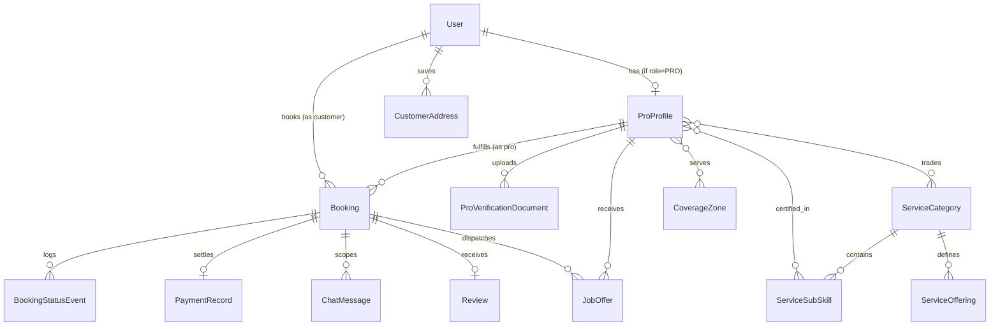

# FIXO — Database Schema Specification (`docs/DATABASE_SCHEMA.md`)

## 1. Design Principles
- **Database Engine**: PostgreSQL 16+ accessed via **Prisma ORM**.
- **Currency**: Stored in integer piastres or decimal EGP (`Decimal(10, 2)`) with explicit `currency = 'EGP'`. For clarity across the MVP, monetary amounts are stored in whole EGP integers (`amountEgp Int`) since Egyptian home service fees, inspection fees, and tips operate in whole EGP denominations.
- **Synthetic Privacy by Default**: National ID numbers and document uploads in development/demo environments must use synthetic test fixtures only. Document URLs point to private object storage keys, never public unauthenticated buckets.
- **Auditability**: Every booking state transition is recorded in `BookingStatusEvent` with actor, timestamp, and optional metadata.

---

## 2. Entity-Relationship Diagram

---

## 3. Enums

| Enum | Values | Purpose |
| --- | --- | --- |
| `UserRole` | `CUSTOMER`, `PRO`, `ADMIN` | Primary account role |
| `ProVerificationStatus` | `DRAFT`, `PENDING_REVIEW`, `ACTION_REQUIRED`, `APPROVED`, `SUSPENDED` | Screen 14 verification states |
| `TransportMode` | `MOTORCYCLE`, `WORK_VAN`, `METRO_BUS` | Screen 11 site visit transport |
| `ExperienceTier` | `JUNIOR_1_2Y`, `SKILLED_3_5Y`, `SENIOR_6_8Y`, `MASTER_8_PLUS_Y` | Screen 12 experience level |
| `DocumentType` | `NATIONAL_ID_FRONT`, `NATIONAL_ID_BACK`, `CRIMINAL_RECORD_CERT`, `SYNDICATE_LICENSE` | Screen 13 document slots |
| `DocumentStatus` | `PENDING`, `VERIFIED`, `REJECTED` | Individual document review status |
| `BookingStatus` | `DRAFT`, `PENDING_DISPATCH`, `OFFERED_TO_PRO`, `CONFIRMED`, `PRO_EN_ROUTE`, `ARRIVED`, `IN_PROGRESS`, `COMPLETED`, `CANCELLED` | Order lifecycle states (Screens 04–09, 15–16) |
| `TimeWindow` | `MORNING_09_12`, `AFTERNOON_13_16`, `EVENING_17_20` | Screen 04 preferred slot |
| `PaymentMethodType` | `CASH_ON_SERVICE`, `INSTAPAY_SANDBOX`, `SMART_WALLET_SANDBOX`, `CARD_MEEZA_SANDBOX`, `FAWRY_SANDBOX` | Screen 05 payment options (`CASH_ON_SERVICE` active in MVP) |
| `PaymentStatus` | `PENDING`, `AUTHORIZED`, `PAID`, `REFUNDED`, `FAILED` | Settlement status |
| `JobOfferStatus` | `PENDING`, `ACCEPTED`, `DECLINED`, `EXPIRED` | Screen 16 incoming request state |

---

## 4. Core Tables / Models

### 4.1 `User` & `OtpChallenge` / `RefreshToken`
- `User`:
  - `id` (UUID PK)
  - `phone` (Unique, E.164 format e.g. `+201023456789`)
  - `fullName` (Nullable during initial phone auth, populated on profile/signup)
  - `email` (Optional unique)
  - `avatarUrl` (Optional)
  - `role` (`UserRole`, default `CUSTOMER`)
  - `preferredLocale` (`en` or `ar`, default `en`)
  - `arrivalAlertsEnabled` (`Boolean`, default `true` — Screen 10)
  - `rewardPoints` (`Int`, default `0` — Screen 10)
  - `createdAt`, `updatedAt`
- `OtpChallenge`:
  - `id` (UUID PK), `phone`, `codeHash`, `expiresAt`, `attempts`, `consumedAt`, `createdAt`
- `RefreshToken`:
  - `id` (UUID PK), `userId` (FK), `tokenHash`, `expiresAt`, `revokedAt`, `createdAt`

### 4.2 `CustomerAddress` & `CoverageZone`
- `CoverageZone`:
  - `id` (UUID PK)
  - `slug` (Unique, e.g. `sheikh-zayed`, `6th-of-october`, `maadi`, `zamalek`, `new-cairo`, `dokki-mohandessin`)
  - `nameEn`, `nameAr`, `governorate` (`Cairo` | `Giza`), `isActive`
- `CustomerAddress`:
  - `id` (UUID PK), `userId` (FK), `zoneId` (FK)
  - `label` (e.g. `Palm Hills Villa 14`), `buildingLine` (e.g. `Apartment 4B, Building 14`), `districtLine` (e.g. `Palm Hills, Sheikh Zayed, Giza`), `gateNotes` (e.g. `Gate 3 pre-cleared`), `latitude`, `longitude`, `isDefault`

### 4.3 `ServiceCategory`, `ServiceSubSkill`, & `ServiceOffering`
- `ServiceCategory` (Screens 03, 12):
  - `id` (UUID PK), `slug`, `nameEn`, `nameAr`, `subtitleEn`, `subtitleAr`, `iconName`, `startingPriceEgp` (`Int`), `sortOrder`, `isActive`
- `ServiceSubSkill` (Screen 12):
  - `id` (UUID PK), `categoryId` (FK), `slug`, `nameEn`, `nameAr`
- `ServiceOffering` (Screens 03, 04):
  - `id` (UUID PK), `categoryId` (FK), `slug`, `titleEn`, `titleAr`, `descriptionEn`, `descriptionAr`, `baseInspectionEgp` (`Int`), `serviceFeeEgp` (`Int`), `estimatedDurationMins` (`Int`), `isSeasonalPromo` (`Boolean`)

### 4.4 `ProProfile` & `ProVerificationDocument` (Screens 11–15)
- `ProProfile`:
  - `id` (UUID PK), `userId` (Unique FK)
  - `dossierCode` (Unique, e.g. `FX-PRO-9921`)
  - `nationalIdSynthetic` (14-digit string, synthetic in demo)
  - `primaryCategoryId` (FK to `ServiceCategory`)
  - `primaryZoneId` (FK to `CoverageZone`)
  - `transportMode` (`TransportMode`)
  - `experienceTier` (`ExperienceTier`)
  - `acceptsStandardRateCard` (`Boolean`, default `true`)
  - `toolkitCommitmentConfirmed` (`Boolean`, default `false`)
  - `verificationStatus` (`ProVerificationStatus`, default `DRAFT`)
  - `reviewerNote` (Optional text — Screen 14 `Action Req.`)
  - `isOnline` (`Boolean`, default `false` — Screen 15 toggle)
  - `vehicleDescription` (Optional, e.g. `White Nissan Sunny`)
  - `vehiclePlateAr` (Optional, e.g. `ب ق د ٤٨٢١`)
  - `ratingAvg` (`Float`, default `5.0`), `completedJobsCount` (`Int`, default `0`), `acceptanceRatePct` (`Int`, default `100`)
- `ProVerificationDocument`:
  - `id` (UUID PK), `proProfileId` (FK), `docType` (`DocumentType`), `fileName`, `fileSizeBytes`, `storageKey`, `status` (`DocumentStatus`), `reviewerComment`, `uploadedAt`

### 4.5 `Booking`, `BookingStatusEvent`, `JobOffer`, `PaymentRecord`, `ChatMessage`, `Review`
- `Booking` (Screens 04–09, 15–16):
  - `id` (UUID PK), `orderCode` (Unique, e.g. `FX-8842`)
  - `customerId` (FK to `User`), `proProfileId` (Nullable FK to `ProProfile`)
  - `offeringId` (FK to `ServiceOffering`), `addressId` (FK to `CustomerAddress`)
  - `status` (`BookingStatus`, default `DRAFT`)
  - `scheduledDate` (`DateTime`), `timeWindow` (`TimeWindow`)
  - `issueDescription` (Optional text), `issuePhotoUrls` (`String[]`)
  - `baseInspectionEgp` (`Int`), `serviceFeeEgp` (`Int`), `transportFeeEgp` (`Int`, default `0`), `totalEgp` (`Int`)
  - `platformFeeEgp` (`Int`), `netArtisanEgp` (`Int`)
  - `arrivalPinCode` (4-digit string, e.g. `5841` — Screen 06)
  - `cancellationReason` (Optional)
  - `createdAt`, `updatedAt`, `completedAt`
- `JobOffer` (Screen 16):
  - `id` (UUID PK), `bookingId` (FK), `proProfileId` (FK), `status` (`JobOfferStatus`), `expiresAt`, `declineReason`, `respondedAt`
- `PaymentRecord` (Screen 05):
  - `id` (UUID PK), `bookingId` (Unique FK), `method` (`PaymentMethodType`, default `CASH_ON_SERVICE`), `status` (`PaymentStatus`), `amountEgp` (`Int`), `tipEgp` (`Int`, default `0`), `externalReference` (Optional), `paidAt`
- `ChatMessage` (Screen 07):
  - `id` (UUID PK), `bookingId` (FK), `senderUserId` (FK), `body`, `attachmentUrl` (Optional), `attachmentCaption` (Optional), `readAt`, `createdAt`
- `Review` (Screen 09):
  - `id` (UUID PK), `bookingId` (Unique FK), `customerId` (FK), `proProfileId` (FK), `rating` (`Int` 1..5), `tags` (`String[]`), `comment` (Optional), `photoUrls` (`String[]`), `tipAmountEgp` (`Int`, default `0`), `createdAt`

