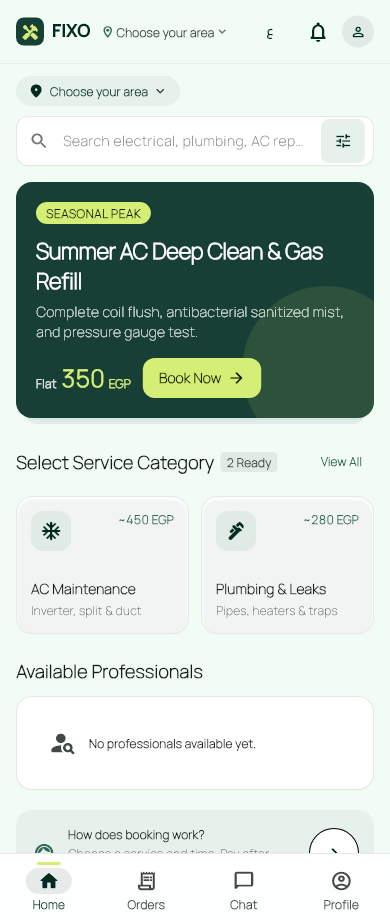
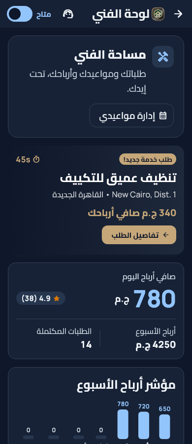
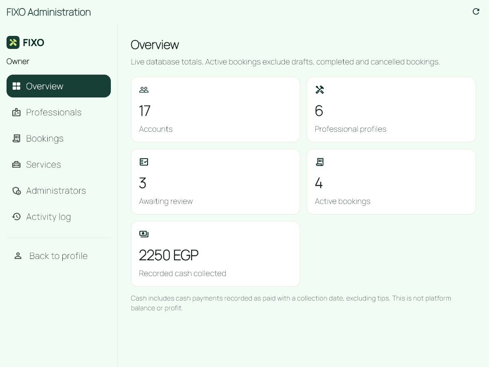

<div align="center">
  
  <h1>FIXO · Home Services</h1>
  <p><strong>Better Homes. Better Everyday.</strong></p>
  <p>A home-services marketplace for Egypt, built with Flutter and a modular NestJS API.</p>
  <p>
    <a href="https://fixo-web-blue.vercel.app">Open FIXO</a> ·
    <a href="https://fixo-home-services-6507.web.app">Firebase mirror</a> ·
    <a href="#getting-started">Getting started</a> ·
    <a href="#documentation">Documentation</a>
  </p>
</div>

---

FIXO connects customers with home-service professionals through one shared application for **Android, iOS and the web**. Customers discover services and manage bookings; professionals manage applications, requests and schedules; administrators review operations in a dedicated workspace.

**Current application branch:** [`fixo-connected-communications`](https://github.com/gamal6507-ops/Fixo_Home_Services/tree/fixo-connected-communications). The repository's default `main` branch may contain an earlier milestone; the setup instructions below select the current application branch explicitly.

**بالعربي:** فيكسو منصة للخدمات المنزلية في مصر، بتجمع العميل والفني والإدارة في تطبيق واحد. تدعم العربي والإنجليزي، الوضع الفاتح والداكن، واختيار المحافظة أو تحديد الموقع بإذن المستخدم. توافر الحجز يعتمد على الخدمات والتغطية المفعّلة فعليًا.

## A workspace for every account

| Account | Workspace | Access |
| --- | --- | --- |
| **Customer** | Services, addresses, bookings, messages and profile | Own account and authorized booking data |
| **Professional** | Onboarding, requests, availability, schedule and earnings | Approved professional operations; registration alone grants no approval |
| **Admin** | Booking operations, professional reviews, catalog and support | Verified, active administration membership |
| **Owner** | Administration plus administrator access management | Configured, verified owner identity only |

All workspaces share the FIXO crest, typography and component system, with distinct accents and task-specific layouts. Profile badges reflect account type and verified administrative membership. **Choosing a screen or editing client data never grants a role.**

## Features

- **Authentication:** Google and verified email through Firebase; phone-and-password access through the FIXO API, without requiring SMS for the primary flow.
- **Session continuity:** secure token storage, session restoration, token rotation and logout cleanup.
- **Discovery:** searchable categories and services, filters, favorites and governorate selection across Egypt.
- **Locations:** manual addresses, optional device geolocation and a MapLibre-based map interface. Booking availability depends on configured coverage.
- **Bookings:** date/time selection, server-provided pricing, tracking, reviews and repeat-booking support.
- **Cash checkout:** cash-on-service confirmation, explicit amounts due and duplicate-safe checkout behavior.
- **Communication:** booking messages, support conversations, in-app updates and opt-in Firebase device-push integration.
- **Profiles:** editable details and photos, camera/gallery selection, language and theme preferences. Logout is available from the profile.
- **Professional onboarding:** legal details, skills, private document submission and administrator review before approved professional actions.
- **Administration:** catalog drafts and publishing, professional reviews, booking operations, audit records and owner-controlled administrator membership.
- **Responsive UI:** mobile/desktop layouts, English LTR, Arabic RTL, light/dark themes and increased text-scale coverage.

## Interface preview

Screenshots below are generated from automated UI tests using **fixture data**, not live customer records.

| Customer · Web & mobile | Professional · Arabic dark mode |
| --- | --- |
|  |  |

<details>
<summary>Owner console · Desktop</summary>



</details>

## Architecture

```text
Flutter · Dart
Android / iOS / Web / Administration
        │
        ├── Firebase Authentication · Google and email identity
        ├── Firebase Cloud Messaging · Opt-in device notifications
        │
        └── HTTPS / REST
                │
          NestJS · TypeScript
          Authentication, authorization and domain services
                │
                ├── Prisma → Supabase PostgreSQL
                └── Authorized server access → Private Supabase Storage
```

The Flutter client uses feature-oriented modules with presentation, domain and data responsibilities. Riverpod manages state, GoRouter handles navigation, and Dio handles API requests and session refresh. The backend owns authorization, pricing validation, booking transitions and persistence.

| Layer | Technology |
| --- | --- |
| Application, website and admin UI | Flutter, Dart, Material UI, Riverpod, GoRouter |
| Networking and session storage | Dio, Flutter Secure Storage |
| API | NestJS, TypeScript, class-validator, Swagger/OpenAPI |
| Database | PostgreSQL, Prisma, Supabase |
| Identity and push | Firebase Authentication, Firebase Cloud Messaging |
| Private media | Supabase Storage through the API |
| Maps and location | MapLibre, Geolocator |
| Hosting | Vercel for API/web; Firebase Hosting for the web mirror |
| Verification | Flutter tests and goldens, Jest, PostgreSQL integration tests, GitHub Actions |

The active backend is **NestJS**, not Dart. The experimental Dart backend is inactive. The separate Next.js website has been retired; web and administration use the shared Flutter application.

## Repository layout

```text
Fixo_Home_Services/
├── README.md
├── .github/workflows/ci.yml
└── Fixo/
    ├── mobile/                 # Shared Flutter application
    │   ├── lib/app/            # Startup, routing and providers
    │   ├── lib/core/           # Themes, networking, sessions and shared widgets
    │   ├── lib/features/       # Customer, professional, admin and domain features
    │   ├── test/               # Behavioral, responsive and golden tests
    │   └── web/                # Bootstrap, push worker and hosting assets
    ├── backend/                # Active NestJS API
    │   ├── src/modules/        # Domain modules and protected endpoints
    │   └── prisma/             # Schema and migrations
    ├── backend_dart/           # Inactive migration experiment
    ├── docs/                   # Architecture, security and delivery notes
    ├── DESIGN.md               # Current visual system
    └── docker-compose.yml     # Local PostgreSQL development service
```

## Getting started

### Prerequisites

- Flutter SDK compatible with [`pubspec.yaml`](Fixo/mobile/pubspec.yaml), including Dart **3.10.8 or later within its supported SDK range**.
- Node.js **24.x**, npm and Git.
- Docker with Compose, or a configured PostgreSQL installation.
- Your own Firebase configuration for sign-in/push; server credentials remain private.
- For native iOS builds: macOS, Xcode and the required Apple signing configuration.

Commands below use **PowerShell**, starting at the repository root.

### 1. Clone and start PostgreSQL

```powershell
git clone --branch fixo-connected-communications https://github.com/gamal6507-ops/Fixo_Home_Services.git
cd Fixo_Home_Services
docker compose -f Fixo/docker-compose.yml up -d
```

The Compose service creates `fixo_dev` on port `5432`. Its development credentials are defined in the Compose file; use separate credentials for hosted environments.

### 2. Configure and start the API

```powershell
cd Fixo/backend
npm ci
if (-not (Test-Path .env)) { Copy-Item .env.example .env }
```

Edit `.env` using [the environment template](Fixo/backend/.env.example):

| Setting | Purpose |
| --- | --- |
| `PORT=3001` | Matches the application's opt-in local API address |
| `DATABASE_URL` | Local development PostgreSQL connection |
| `JWT_ACCESS_SECRET`, `JWT_REFRESH_SECRET`, `OTP_HMAC_SECRET` | Independent, cryptographically random secrets |
| `ALLOW_IN_MEMORY_FALLBACK=false` | Require real persistence for local end-to-end work |
| `FIREBASE_PROJECT_ID`, `FIREBASE_WEB_API_KEY` | Firebase identity integration |
| `FIREBASE_SERVICE_ACCOUNT_JSON` | Server-only identity administration and FCM credentials |
| `FIREBASE_WEB_VAPID_KEY` | Public browser-push configuration |
| `SUPABASE_URL`, `SUPABASE_SERVICE_ROLE_KEY` | Server-only private media access |
| `FIXO_OWNER_EMAIL` | Verified account eligible for Owner membership |

Generate each secret independently, for example:

```powershell
node -e "console.log(require('crypto').randomBytes(32).toString('hex'))"
```

Apply migrations and start the server:

```powershell
npx prisma migrate deploy
npm run start:dev
```

For a fresh **local development database only**, `npm run seed:catalog` can populate the sample catalog. Review the target before running a seed; hosted catalog publication is managed separately through administration.

With port `3001`, the local API is `http://localhost:3001/api/v1` and development Swagger documentation is `http://localhost:3001/api/docs`. Hosted Swagger is controlled by server configuration.

### 3. Run Flutter

Open a second terminal at the repository root:

```powershell
cd Fixo/mobile
flutter pub get
flutter run -d chrome --dart-define=FIXO_USE_LOCAL_API=true
```

For a selected Android emulator:

```powershell
flutter run --dart-define=FIXO_USE_LOCAL_API=true
```

The local flag uses `10.0.2.2:3001` on Android emulators and `localhost:3001` on web/desktop/iOS simulators. For a physical phone, provide a reachable development-server address:

```powershell
flutter run --dart-define=FIXO_API_BASE_URL=http://YOUR_LAN_IP:3001/api/v1
```

**Without either override, the client defaults to the hosted FIXO API.** Choose the intended environment before creating test accounts or bookings. Run Flutter commands from `Fixo/mobile`, where `pubspec.yaml` lives.

Configure Firebase for your own project/platform apps before testing identity and notifications. Device permissions require explicit user opt-in; native iOS push also needs APNs configuration.

## Testing

From `Fixo/mobile`:

```powershell
flutter analyze
flutter test
```

From `Fixo/backend`:

```powershell
npm run lint
npm test
npm run build
```

Backend integration tests require a migrated, isolated **`fixo_test` database on `localhost:5432`** and an explicit `TEST_DATABASE_URL`. They may create and clean up test records. Never point the suite at `fixo_dev` or a hosted database. See [database setup](Fixo/docs/DATABASE_SETUP.md) and the [CI workflow](.github/workflows/ci.yml) for the test database/migration sequence.

Last recorded full verification, **17 November 2026**: **613 Flutter tests** passed with two existing opt-in skips, and **572 backend tests across 62 suites** passed. These are recorded release results, not a claim that every live device/provider path has been tested. See the [workspace release notes](Fixo/docs/ROLE_WORKSPACES_RELEASE_2026-11-17.md).

## Security and service boundaries

- Firebase proves Google/email identity; the FIXO API validates identity and controls application sessions and permissions.
- Owner/Admin authority comes from verified server membership, not an email typed into a form or a client-side role switch.
- Data and private files are accessed through authorized server operations. Supabase service-role keys and Firebase service-account credentials never belong in Flutter, browser bundles or Git.
- Document submission supports private manual review; it does not imply government verification or guaranteed approval.
- Keep secrets and local environment files out of source control. Development SMS bypasses and in-memory/demo flags must not be enabled in production.
- Firebase handles authentication/notifications; PostgreSQL and private media remain on Supabase.

## Current delivery boundaries

| Area | Current scope |
| --- | --- |
| Web and API | Existing Vercel deployments; web mirror on Firebase Hosting |
| Android | Buildable Flutter application; development APK verification recorded |
| iOS | Shared Flutter implementation; native builds, signing and device verification require macOS/Apple setup |
| Payments | Cash-on-service flow; electronic methods need provider activation and verification before being presented as live |
| Apple sign-in | iOS-oriented integration; activation depends on Apple/Firebase configuration |
| Device push | FCM integration; actual delivery depends on user permission, device registration and platform credentials |
| Service coverage | Egypt-wide location selection; bookable services depend on active catalog/coverage configuration |
| Store distribution | Google Play and App Store publication is separate from web/API deployment |

## Documentation

- [Architecture](Fixo/docs/ARCHITECTURE.md)
- [API contract](Fixo/docs/API_CONTRACT.md)
- [Database schema](Fixo/backend/prisma/schema.prisma) and [local setup](Fixo/docs/DATABASE_SETUP.md)
- [Visual system](Fixo/DESIGN.md)
- [Role workspaces and verification](Fixo/docs/ROLE_WORKSPACES_RELEASE_2026-11-17.md)
- [Unified Flutter delivery](Fixo/docs/UNIFIED_FLUTTER_RELEASE_2026-11-17.md)
- [Security notes](Fixo/docs/SECURITY.md)
- [Apple and payment activation](Fixo/docs/PAYMENT_APPLE_ACTIVATION.md)

Some older documents describe previous milestones or experiments; prefer the current source and dated release notes when details differ.

## License

This repository does not currently publish an open-source license. The backend package is marked `UNLICENSED`. Third-party packages, fonts and bundled location data retain their respective licenses.
